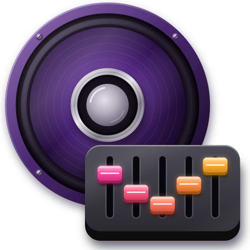

# ToneDesk

Controle de áudio completo para macOS na barra de menus — volume independente por aplicativo, roteamento multi-dispositivo, correção de sala/fones (AutoEQ / REW de até 64 filtros), equalizador paramétrico global com gráfico interativo, cenas rápidas (*Quick Configs*), controles estéreo avançados e medidor ao vivo na barra de menus.

Mantido por **Karel Cristian** (`com.karel.ToneDesk`) — derivado de [FineTune](https://github.com/ronitsingh10/FineTune) sob licença **GPL-3.0**.

<br clear="all"/>

---

## O que foi construído e evoluído no ToneDesk

Este projeto evoluiu a base original do FineTune para uma estação pessoal definitiva de controle e calibração de áudio no macOS 15+:

### 1. Identidade, Ícones e Autonomia
- **Renomeação completa para ToneDesk** (`com.karel.ToneDesk`, esquema de URL `tonedesk://`, armazenamento isolado em `~/Library/Application Support/ToneDesk/`).
- **Novo ícone do app (`AppIcon.appiconset`)** com todos os 10 slots nativos do macOS (16×16 até 1024×1024 px) e remoção do bundle antigo `fineTuneIcon.icon`.
- **Novo glifo da barra de menus (`MenuBarIcon.imageset`)** em 18/36/54 px configurado como *Template Image* para adaptação automática a barras claras e escuras.
- **Remoção de atualizações externas (Sparkle) e links de terceiros:** aba *Updates* removida de Settings, `UpdateManager` desativado na inicialização e links externos de doação/repositório upstream removidos. Autoria atualizada para **Karel Cristian** (`About` e `NSHumanReadableCopyright`).

### 2. Equalização Paramétrica Global, AutoEQ (64 filtros) & Comparação A/B
- **Global Parametric EQ por dispositivo (`DeviceParametricEQEditorView`):**
  - Gráfico interativo de resposta de frequência (**20 Hz – 20 kHz**) em Dark e Light Mode com grade, eixos, preenchimento e legenda **Combined + AutoEQ** quando ambos estão ativos.
  - Alças arrastáveis diretamente no gráfico com *z-order* dinâmico (banda selecionada sempre acima), pills para adicionar/alternar/habilitar/remover bandas, seletor **Peak / Low Shelf / High Shelf** e sliders monoespaçados **Preamp, Freq, Gain e Q** com auto-scroll para visibilidade imediata em *Compact*.
  - Mini-gráfico clicável no inspector recolhido e exportação direta da curva para a biblioteca de perfis.
- **Suporte a até 64 filtros por perfil REW / Equalizer APO:**
  - Aplicação fiel dos coeficientes RBJ em 44.1, 48 e 96 kHz sem *pre-warping* indevido em arquivos importados.
  - Troca de perfil/preamp livre de cliques com crossfade de 25 ms na thread de áudio.
  - Preservação do preamp fixo do PEQ mesmo quando o preamp do AutoEQ é desativado.
- **Biblioteca de Perfis (`Settings › Profiles`):**
  - Importação em lote de arquivos `.txt` ou pastas (inclusive via drag & drop), favoritos, renomeação, reordenação, visualização expandida com gráfico acima da tabela de filtros e backup/restauração em `.zip`.
  - Fallback por nome + fabricante do dispositivo para manter o perfil ativo mesmo trocando de porta USB.
  - **Comparação A/B com *Level-Match* (LUFS K-weighted):** alternância rápida por clique, menu de contexto ou atalho global.

### 3. Quick Configs (Cenas de Áudio)
- Captura e restauração instantânea de snapshots completos (saída/entrada padrão, volumes, perfis AutoEQ, PEQ paramétrico, processamento estéreo e roteamento de apps).
- Criação inline direto no cabeçalho do popup, atualização rápida (`Update "…"`), checkmark nativo na cena recém-aplicada (no menu do popup e no clique direito da barra de menus), gerenciamento completo em `Settings › Audio → Quick Configs` (Apply, Rename inline, Update com confirmação, Delete com confirmação) e atalho global **Next Quick Config**.

### 4. Controles Estéreo, Proteção de Volume & Dispositivos
- **Balance L/R** por dispositivo e por aplicativo (`BalanceSliderRow`, clique no valor para resetar a `Center`, pílula compacta `L30`/`R20` na `AppRow`).
- **Mono** e **Swap L⇄R** por dispositivo.
- **Max Volume Limit** (proteção auditiva configurável, ex. `≤ 70%`, com clamp imediato no slider e no volume real).
- **Badges responsivos na `DeviceRow` (`BadgeFlowLayout`):** badges compactos (`PEQ`, `L/R`, `Mono`, `Swap`, `≤70%`) preservam largura legível e quebram linha automaticamente em *Compact* sem truncar nem esmagar o nome ou o slider.
- **Bluetooth Output Only (Keep Music Quality):** evita troca automática para o perfil SCO/HFP de baixa qualidade em headsets Bluetooth.
- **Estabilidade de Sample Rate:** recriação automática dos *process taps* quando qualquer dispositivo de saída muda de taxa de amostragem.

### 5. Barra de Menus, Pin Flutuante e Janelas
- **Live Level Meter** (medidor VU de 2 barras em tempo real) + **Porcentagem de Volume (`XX%` / `Muted`)** opcionais ao lado do ícone da barra de menus.
- **Controles rápidos no ícone (`Icon Scroll & Option-Click`):** opt-in em *Settings → General → Menu Bar* com monitor local prioritário (antes do `FluidMenuBarExtra`) + monitor global para funcionar mesmo com outro app em foco — scroll suave ajusta o volume (com proteção contra inércia de trackpad e limite por evento), Option-click e middle-click alternam mute sem abrir o popup.
- **Menu nativo de clique direito:** dispositivo ativo, Mute/Unmute, Switch Output Device, perfis de EQ, A/B, Quick Configs (`✓ last applied`) e *Manage Profile Library…*.
- **Pin Flutuante (`PinnedPopupWindowController`):** mantém o popup flutuando acima das demais janelas ao clicar fora, reseta corretamente ao esconder/reabrir pelo ícone e desafixa/fecha limpo com `Esc`.
- **Sempre na frente (`WindowFrontPresenter`):** janela de Settings e `NSOpenPanel` de importação abrem imediatamente na frente de outras janelas.

---

## Armazenamento de Dados

- **Configurações:** `~/Library/Application Support/ToneDesk/settings.json` (schema v13)
- **Perfis AutoEQ / PEQ:** `~/Library/Application Support/ToneDesk/AutoEQ/`

---

## Build, Testes e Instalação Local

Requisitos: **macOS 15+** e **Xcode** instalado.

```bash
# Executar a suíte completa de testes automatizados (1.080 testes)
xcodebuild test -project FineTune.xcodeproj -scheme FineTune \
  -destination 'platform=macOS' -only-testing:FineTuneTests

# Compilar versão Release
xcodebuild build -project FineTune.xcodeproj -scheme FineTune \
  -configuration Release -destination 'platform=macOS'
```

O aplicativo compilado é gerado em `DerivedData/.../Build/Products/Release/ToneDesk.app` e pode ser copiado diretamente para `/Applications/ToneDesk.app`.

---

## Licença

Distribuído sob a licença **GNU General Public License v3.0** ([LICENSE](LICENSE)), mantendo a licença da base original FineTune.
