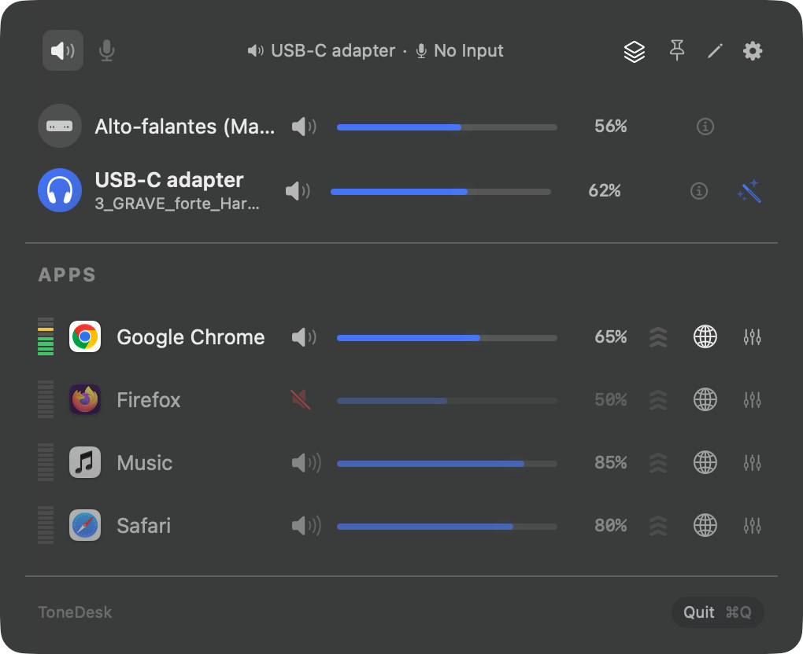
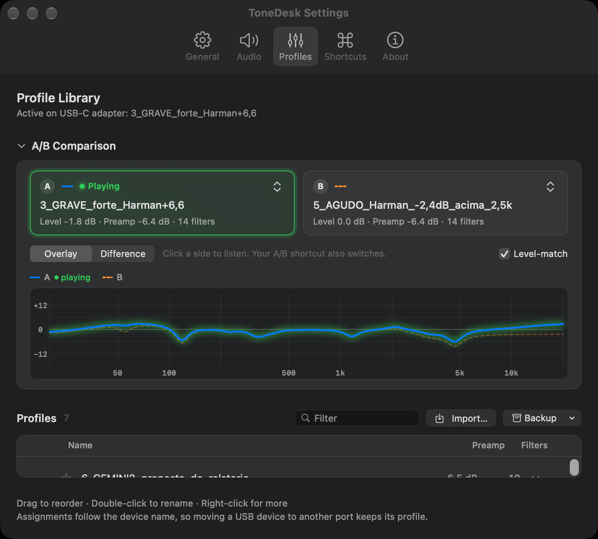

<p align="center">
  
</p>

<h1 align="center">ToneDesk</h1>

<p align="center">
  Controle de áudio do macOS na barra de menus: volume por app, saída por app, correção de fones e caixas (AutoEQ/REW) e cenas de áudio com um clique.
</p>

<p align="center">
  macOS 15.4+ · GPL-3.0 · derivado do <a href="https://github.com/ronitsingh10/FineTune">FineTune</a>
</p>

<p align="center">
  
  
</p>

## Recursos

**Volume e saída por app**
- Volume, mudo e balanço L/R independentes para cada app.
- Mande cada app para uma saída diferente (ex.: música no DAC, chamadas no fone Bluetooth).
- Limite de volume máximo por dispositivo, para proteger a audição.
- Mono e inversão L⇄R por dispositivo.

**Equalização**
- EQ paramétrico por dispositivo, editado direto no gráfico de resposta de frequência.
- Perfis AutoEQ / REW / Equalizer APO com até 64 filtros, aplicados sem cliques na troca.
- Biblioteca de perfis com favoritos, prévia da curva, backup em `.zip` e associação automática ao dispositivo (mesmo trocando de porta USB).
- **Comparação A/B** entre dois perfis com nivelamento de volume (LUFS), por clique ou atalho global.

**Quick Configs**
- Salve o estado inteiro (saídas, volumes, EQ, roteamento dos apps) como uma cena e restaure com um clique ou atalho.

**Barra de menus**
- Medidor de nível e porcentagem de volume ao lado do ícone (opcional).
- Rolagem no ícone ajusta o volume; Option-clique silencia.
- Clique direito abre um menu rápido com dispositivo, perfis de EQ, A/B e Quick Configs.
- Fixe o popup para ele continuar aberto sobre as outras janelas.

## Instalação

Ainda não há versão compilada para download. Para compilar:

```bash
git clone https://github.com/karellima/ToneDesk.git
cd ToneDesk
xcodebuild build -project FineTune.xcodeproj -scheme FineTune \
  -configuration Release -destination 'platform=macOS'
```

Copie o `ToneDesk.app` gerado (em `DerivedData/…/Build/Products/Release/`) para `/Applications`.

### Permissões

Na primeira vez, o macOS pede:

| Permissão | Para quê |
|---|---|
| Gravação de áudio do sistema | Controlar o volume de cada app (obrigatória) |
| Microfone | Só para apps que usam dispositivos com entrada |
| Bluetooth | Conectar dispositivos pareados pelo menu |
| Acessibilidade | Teclas de mídia e atalhos globais (opcional) |

## Primeiros passos

1. Clique no ícone da barra de menus e ajuste o volume de cada app.
2. Para corrigir um fone: **Settings › Profiles › Import…** e escolha o `.txt` do [AutoEQ](https://autoeq.app) ou do REW. Veja o [guia de AutoEQ](guide/autoeq.md).
3. Para comparar dois perfis: escolha A e B em **Settings › Profiles** e clique no lado que quer ouvir.
4. Para salvar uma cena: no popup, crie uma Quick Config pelo cabeçalho.

## Automação

Controle o ToneDesk por URL, em scripts ou atalhos:

```bash
open "tonedesk://set-volumes?app=com.spotify.client&volume=50"
open "tonedesk://toggle-mute?app=com.hnc.Discord"
```

Todos os comandos estão em [guide/url-schemes.md](guide/url-schemes.md). Problemas comuns: [guide/troubleshooting.md](guide/troubleshooting.md).

## Dados

Tudo fica em `~/Library/Application Support/ToneDesk/`:
- `settings.json` — configurações
- `AutoEQ/` — perfis importados

Para começar do zero, feche o app e apague a pasta.

## Desenvolvimento

```bash
xcodebuild test -project FineTune.xcodeproj -scheme FineTune \
  -destination 'platform=macOS' -only-testing:FineTuneTests
```

O projeto e o scheme mantêm o nome `FineTune` para facilitar a sincronização com o upstream. Regras de código e de áudio em tempo real: [CONTRIBUTING.md](CONTRIBUTING.md).

<details>
<summary>O que muda em relação ao FineTune</summary>

- Identidade própria: `com.karel.ToneDesk`, esquema `tonedesk://`, dados em pasta separada.
- EQ paramétrico por dispositivo com gráfico interativo.
- Perfis com até 64 filtros, biblioteca, backup e comparação A/B com nivelamento.
- Quick Configs.
- Balanço, mono, inversão L⇄R e limite de volume.
- Medidor de nível, rolagem e menu de clique direito na barra de menus; popup fixável.
- Modo "Bluetooth Output Only", que evita o perfil de chamada de baixa qualidade.
- Sem atualização automática (Sparkle) nem links de doação.

</details>

## Créditos e licença

Baseado no [FineTune](https://github.com/ronitsingh10/FineTune), de Ronit Singh. Mantido por Karel Cristian.
Distribuído sob a [GNU GPL v3.0](LICENSE), a mesma licença do projeto original.
